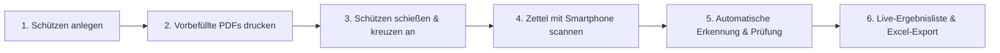
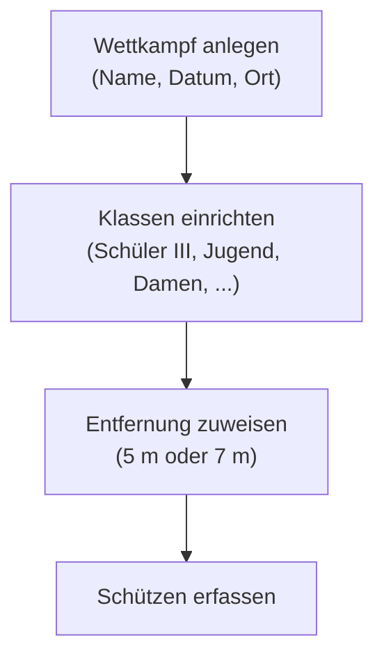

# bgScore – Benutzerhandbuch

> **Offizielles Benutzerhandbuch für bgScore**  
> Die moderne Webanwendung zur automatischen, optischen Erfassung und Auswertung von Blasrohr-Schießzetteln (Wertungsbögen).

---

## Inhaltsverzeichnis

1. [Über bgScore](#1-über-bgscore)
   - [Ziel und Funktionsweise](#ziel-und-funktionsweise)
   - [Aufbau der Schießzettel (Zettel A & Zettel B)](#aufbau-der-schießzettel-zettel-a--zettel-b)
2. [Systemvoraussetzungen & Installation](#2-systemvoraussetzungen--installation)
   - [Systemanforderungen](#systemanforderungen)
   - [Installation unter Windows (Schnellstart)](#installation-unter-windows-schnellstart)
   - [Manuelle Installation über Python & pip](#manuelle-installation-über-python--pip)
3. [Netzwerk & mobile Nutzung (Smartphone / Tablet)](#3-netzwerk--mobile-nutzung-smartphone--tablet)
   - [Einsatz im lokalen WLAN](#einsatz-im-lokalen-wlan)
   - [Verbindung per QR-Code ("Handy-Link")](#verbindung-per-qr-code-handy-link)
   - [Live-Kamera vs. System-Kamera (HTTPS-Hinweis)](#live-kamera-vs-system-kamera-https-hinweis)
4. [Wettkampf & Klassen verwalten](#4-wettkampf--klassen-verwalten)
   - [Neuen Wettkampf anlegen](#neuen-wettkampf-anlegen)
   - [Klassen konfigurieren & Entfernungsregeln (5 m vs. 7 m)](#klassen-konfigurieren--entfernungsregeln-5-m-vs-7-m)
   - [Zwischen Wettkämpfen wechseln](#zwischen-wettkämpfen-wechseln)
5. [Schützenverwaltung & Startlisten](#5-schützenverwaltung--startlisten)
   - [Schützen vorab erfassen](#schützen-vorab-erfassen)
   - [Schnellanlage direkt im Scan-Dialog](#schnellanlage-direkt-im-scan-dialog)
   - [Gruppen- und Standnummern zuweisen](#gruppen--und-standnummern-zuweisen)
6. [Schießzettel drucken (PDF-Generator)](#6-schießzettel-drucken-pdf-generator)
   - [Vorbefüllte Schießzettel mit individuellem QR-Code](#vorbefüllte-schießzettel-mit-individuellem-qr-code)
   - [Druckmodi: Gesamt, pro Klasse, pro Verein, pro Gruppe](#druckmodi-gesamt-pro-klasse-pro-verein-pro-gruppe)
   - [Leere Schießzettel als Reserve](#leere-schießzettel-als-reserve)
7. [Zettelauswertung & Bilderkennung](#7-zettelauswertung--bilderkennung)
   - [Der Auswertungs-Ablauf im Überblick](#der-auswertungs-ablauf-im-überblick)
   - [Vollautomatische Erkennung via QR-Code (Empfohlen)](#vollautomatische-erkennung-via-qr-code-empfohlen)
   - [Manuelle Schützen- und Hälftenauswahl](#manuelle-schützen--und-hälftenauswahl)
   - [Fotoaufnahme: Live-Kamera mit Zielrahmen vs. Schnappschuss](#fotoaufnahme-live-kamera-mit-zielrahmen-vs-schnappschuss)
   - [Fototipps für eine Trefferquote von 100 %](#fototipps-für-eine-trefferquote-von-100-)
   - [Kontrolle & interaktive Nachkorrektur](#kontrolle--interaktive-nachkorrektur)
   - [Manuelle Direkteingabe (ohne Foto)](#manuelle-direkteingabe-ohne-foto)
8. [Ergebnisliste, Rangfolge & Live-Ticker](#8-ergebnisliste-rangfolge--live-ticker)
   - [Automatische Rangermittlung & Tie-Breaking (10er / 9er)](#automatische-rangermittlung--tie-breaking-10er--9er)
   - [Live-Aktualisierung im Schützenhaus (Echtzeit-Modus)](#live-aktualisierung-im-schützenhaus-echtzeit-modus)
   - [Filterung nach Klassen & Blitzsuche](#filterung-nach-klassen--blitzsuche)
9. [Export & Siegerehrung](#9-export--siegerehrung)
   - [Formatierter Excel-Export (.xlsx)](#formatierter-excel-export-xlsx)
   - [Universeller CSV-Export (.csv)](#universeller-csv-export-csv)
10. [Datensicherung, Wartung & Fehlerbehebung (FAQ)](#10-datensicherung-wartung--fehlerbehebung-faq)

---

## 1. Über bgScore

### Ziel und Funktionsweise
**bgScore** wurde speziell für Blasrohrsport-Wettbewerbe (Vereinsmeisterschaften, Kreis-, Bezirks-, Landesmeisterschaften und Turniere) entwickelt. Bisher mussten Schießleiter und Helfer nach jedem Durchgang Dutzende Papier-Wertungsbögen per Hand zusammenrechnen, die Kreuzchen einzeln kontrollieren und die Zahlen mühsam in Tabellen abtippen.

Mit **bgScore** wird dieser Ablauf komplett digitalisiert und beschleunigt:
1. **Druck:** Sie generieren vor dem Turnier offizielle Schießzettel, die bereits Schütze, Verein, Klasse, Stand und einen verschlüsselten Header-QR-Code enthalten.
2. **Foto:** Nach dem Durchgang fotografieren Sie den Schießzettel einfach mit dem Smartphone oder einer Webcam ab.
3. **Erkennung:** Die integrierte Bildverarbeitung (Computer Vision) entzerrt das Bild automatisch, liest den QR-Code (Schütze + Zettel A oder B) und ermittelt die angekreuzten Ringe aller 5 Passen in Sekundenbruchteilen – ohne externe Cloud oder KI-Abo!
4. **Ergebnis:** Die Treffer werden sofort in die Live-Rangliste übernommen, Ränge nach DSB-Regeln berechnet und auf Knopfdruck als fertige Excel- oder CSV-Tabelle exportiert.



---

### Sportliche Grundlagen
Ein regulärer Blasrohr-Wettkampf nach der Sportordnung des Deutschen Schützenbundes (DSB) umfasst:
- **Gesamt:** 60 Pfeile (10 Passen zu je 6 Pfeilen).
- **Aufteilung in zwei Hälften:**
  - **1. Hälfte (Zettel A):** Passe 1 bis 5 (30 Pfeile, max. 300 Ringe).
  - **2. Hälfte (Zettel B):** Passe 6 bis 10 (30 Pfeile, max. 300 Ringe).
- **Maximaler Gesamtwert:** 600 Ringe.
- **Ringe pro Pfeil:** 10, 9, 8, 7, 6 oder 0 (Miss / Fehlschuss).
- **Entfernungen:**
  - **5 Meter:** Schülerklasse III (bis 10 Jahre) sowie bei Bedarf Sonderklassen.
  - **7 Meter:** Alle übrigen Klassen (Schüler II, Schüler I, Jugend, Damen, Herren, Senioren).

---

### Aufbau der Schießzettel (Zettel A & Zettel B)
Jeder Schütze erhält für seinen Wettkampf zwei getrennte Zettel (oder einen doppelseitig bedruckten Bogen):
- **Zettel A (1. Hälfte):**
  - Kopfdaten: Wettbewerb, Name, Vorname, Verein, Datum, Klasse, Entfernung, Gruppe, Standnummer.
  - **QR-Code oben rechts:** Enthält alle Kopfdaten komprimiert in einem Scan-Code.
  - 5 Passe-Tabellen für **Passe 1 bis 5**. Jede Tabelle besitzt 6 Spalten (Pfeil 1 bis 6) und Zeilen für 10, 9, 8, 7, 6 und 0 sowie eine Summenzeile.
  - Rechts unten: Kasten für die Summe der 1. Hälfte, Anzahl 10er und 9er sowie Unterschriften.
- **Zettel B (2. Hälfte):**
  - Identischer Kopf mit Verweis auf "2. Hälfte".
  - 5 Passe-Tabellen für **Passe 6 bis 10**.
  - Rechts unten: Kasten für die Summe der 2. Hälfte, Anzahl 10er und 9er.

---

## 2. Systemvoraussetzungen & Installation

### Systemanforderungen
- **Betriebssystem:** Windows 10/11, macOS oder Linux.
- **Python:** Python 3.10 oder neuer (empfohlen: Python 3.11 / 3.12).
- **Webbrowser:** Chrome, Edge, Firefox oder Safari (auf PC, Laptop, Tablet oder Smartphone).
- **Netzwerk:** Für die Smartphone-Kopplung sollten PC und Smartphone im selben WLAN (oder Handy-Hotspot) angemeldet sein.

---

### Installation unter Windows (Schnellstart)
1. **Projektordner öffnen:** Entpacken Sie bgScore oder klonen Sie das Repository in einen lokalen Ordner (z. B. `C:\bgScore`).
2. **Abhängigkeiten installieren:**  
   Öffnen Sie die Eingabeaufforderung (PowerShell oder CMD) im Ordner und führen Sie aus:
   ```powershell
   pip install -r requirements.txt
   ```
3. **Start per Doppelklick:**  
   Klicken Sie doppelt auf die Datei **`start_bgscore.bat`**.
   - Das Konsolenfenster öffnet sich.
   - Ihr Standard-Webbrowser öffnet sich automatisch unter `http://localhost:5000`.

---

### Manuelle Installation über Python & pip
Falls Sie ein anderes Betriebssystem nutzen oder den Server manuell in der Konsole starten möchten:
```bash
# 1. Virtuelle Umgebung erstellen (optional, aber empfohlen)
python -m venv venv
# Unter Windows:
venv\Scripts\activate
# Unter Linux / macOS:
source venv/bin/activate

# 2. Pakete installieren
pip install -r requirements.txt

# 3. Server starten
python app.py
```
Der Server lauscht auf allen lokalen Netzwerk-Schnittstellen (`0.0.0.0:5000`) und stellt die Anwendung bereit.

---

## 3. Netzwerk & mobile Nutzung (Smartphone / Tablet)

bgScore ist als **responsives Multi-Device-System** ausgelegt. Der Hauptrechner (z. B. der Vereins-Laptop) dient als Zentralserver, während Schießleiter und Helfer mit ihren eigenen Smartphones Schießzettel direkt an der Schießlinie oder am Auswertungstisch fotografieren.

### Einsatz im lokalen WLAN
1. Verbinden Sie den PC und die Smartphones mit demselben WLAN-Netzwerk (z. B. Vereinsheim-WLAN oder mobiler Hotspot eines Handys).
2. Starten Sie bgScore auf dem PC.

### Verbindung per QR-Code ("Handy-Link")
1. Klicken Sie in der Kopfzeile von bgScore auf den Button **📱 Handy-Link** (oben rechts).
2. Es öffnet sich ein Fenster mit einem Verbindungs-QR-Code und der lokalen IP-Adresse (z. B. `http://192.168.178.45:5000`).
3. Öffnen Sie die Standard-Kamera-App auf Ihrem Smartphone und richten Sie sie auf den Bildschirm.
4. Tippen Sie auf den angezeigten Link – bgScore öffnet sich direkt im mobilen Browser des Smartphones!

---

### Live-Kamera vs. System-Kamera (HTTPS-Hinweis)
Moderne Mobil-Betriebssysteme (iOS Safari, Android Chrome) verlangen für den direkten Zugriff auf den kontinuierlichen Video-Stream (`getUserMedia` / Live-Kamera) aus Sicherheitsgründen eine verschlüsselte Verbindung (**HTTPS**).

bgScore bietet hierfür zwei nahtlose Lösungen:

| Methode | Verbindung | Funktionsweise & Bedienung |
| :--- | :--- | :--- |
| **Option A: System-Kamera (Empfohlen bei Standard-WLAN)** | HTTP oder HTTPS | Tippen Sie auf **📷 System-Kamera / Foto**. Das Handy öffnet die normale Kamera-App. Sie machen ein Foto und tippen auf *Foto verwenden*. Funktioniert immer, ohne Zertifikatswarnungen. |
| **Option B: Live-Kamera mit Zielrahmen** | HTTPS (`port 5443`) | Zeigt das Live-Bild im Browser mit eingeblendetem 5-Passen-Zielrahmen an. Bei vorhandenen Zertifikatsdateien (`cert.pem` und `key.pem`) startet bgScore automatisch auf Port `5443`. *(Hinweis: Beim ersten Aufruf muss die Browser-Warnung für das lokale Zertifikat einmalig bestätigt werden).* |

---

## 4. Wettkampf & Klassen verwalten

Über den Reiter **⚙️ Wettkampf & Klassen** steuern Sie Turniere und Wertungsklassen.



### Neuen Wettkampf anlegen
1. Wechseln Sie auf den Tab **⚙️ Wettkampf & Klassen**.
2. Geben Sie den Namen (z. B. *Vereinsmeisterschaft 2026*), das Datum und optional den Austragungsort ein.
3. Lassen Sie das Häkchen bei *Standard-Klassen direkt anlegen* aktiviert, um die typischen DSB-Klassen automatisch zu laden.
4. Klicken Sie auf **+ Wettkampf erstellen**.

### Klassen konfigurieren & Entfernungsregeln (5 m vs. 7 m)
Im Blasrohrsport hängt die Schussdistanz von der Altersklasse ab:
- Enthält der Klassenname den Text `5 m` oder `5m` (z. B. **Schüler III (5 m)**), setzt bgScore die Entfernung auf den Schießzetteln und in der Auswertung **automatisch auf 5 m**.
- Alle übrigen Klassen (Schüler II, Schüler I, Jugend, Damen, Herren, Senioren etc.) werden **automatisch auf 7 m** gesetzt.
- Über die praktischen **Schnell-Vorlagen**-Chips können Sie mit einem einzigen Klick weitere Klassen wie *Damen*, *Herren* oder *Handicap* ergänzen oder die Sortierreihenfolge per Drag-and-Drop anpassen.

### Zwischen Wettkämpfen wechseln
In der oberen Kopfleiste befindet sich das Dropdown-Menü **Wettkampf**. Hier können Sie jederzeit zwischen archivierten Turnieren und dem aktuellen Wettkampf umschalten. Alle Schützen, Scans und Ranglisten passen sich sofort an.

---

## 5. Schützenverwaltung & Startlisten

Der Tab **🎯 Schützen** dient der Erfassung und Pflege aller Teilnehmer.

### Schützen vorab erfassen
1. Tragen Sie **Nachname** und **Vorname** ein.
2. Geben Sie den **Verein** ein.
3. Wählen Sie die passende **Klasse** aus.
4. Optional: Geben Sie **Gruppe** (z. B. *Durchgang 1* oder *Gruppe A*) und **Standnummer** (z. B. *3*) ein.
5. Klicken Sie auf **+ Schütze speichern**.

### Schnellanlage direkt im Scan-Dialog
Sollte während des Turniers ein Schütze noch nicht im System vorhanden sein, müssen Sie den Scanvorgang nicht abbrechen:
- Neben der Schützenauswahl im Auswerten-Tab befindet sich der Button **+ Neuer Schütze**.
- Ein kompaktes Pop-up erlaubt das Anlegen in 5 Sekunden – der neue Schütze ist danach sofort für den aktuellen Scan ausgewählt.

### Gruppen- und Standnummern zuweisen
Die Zuordnung zu Gruppen und Ständen erleichtert die Organisation ungemein:
- Beim Erstellen der PDFs können Schießzettel nach Durchgang oder Scheibennummer sortiert gedruckt werden.
- In der Live-Ergebnisliste kann nach Ständen und Gruppen gefiltert werden, um sofort zu sehen, wer an Scheibe 4 noch nicht abgegeben hat.

---

## 6. Schießzettel drucken (PDF-Generator)

Ein Highlight von bgScore ist der integrierte **Schießzettel-Generator nach DSB-Norm**. Er erspart das mühsame handschriftliche Ausfüllen von Hunderten Zetteln vor dem Schießen.

Öffnen Sie den Dialog über den Button **📄 Schießzettel-PDF** (in der Kopfzeile oder im Schützen-Tab).

```
+-------------------------------------------------------------------+
|  Blasrohrsport - Ergebniszettel               [ QR-CODE ]         |
|  Wettbewerb: Vereinsmeisterschaft 2026       BG1|1|Vereinsm.|...  |
|  Name: Mustermann, Max       Verein: SV Grün-Weiß                 |
|  Klasse: Herren              Entfernung: 7 m    Stand: 4          |
+-------------------------------------------------------------------+
|  [Passe 1]       [Passe 2]       |  1. Hälfte Summe: [       ]    |
|  [Passe 3]       [Passe 4]       |  10er: [   ]   9er: [   ]      |
|  [Passe 5]       [Unterschrift]  |  Unterschriften:               |
+-------------------------------------------------------------------+
```

### Vorbefüllte Schießzettel mit individuellem QR-Code
Die generierten PDFs enthalten im Kopfbereich bereits gestochen scharf:
- Wettbewerb & Datum
- Name & Vorname des Schützen
- Verein
- Klasse & automatisch ermittelte Schussdistanz (5 m / 7 m)
- Gruppe & Standnummer
- **Kompakter QR-Code:** Beinhaltet alle Headerdaten und die Zettelhälfte (A oder B). Beim späteren Fotografieren liest die Software diese Daten aus – Verwechslungen sind ausgeschlossen!

### Druckmodi: Gesamt, pro Klasse, pro Verein, pro Gruppe
Sie können wählen, wie die PDFs generiert werden sollen:
1. **📚 Gesamt:** Ein einziges zusammenhängendes PDF mit allen Schützen (ideal für den schnellen Komplettdruck).
2. **🏷️ Pro Klasse:** Erzeugt für jede Klasse ein separates PDF (z. B. *Schüler_III.pdf*, *Herren.pdf*).
3. **🛡️ Pro Verein:** Erzeugt pro Gastverein ein PDF (ideal, um Vereinen ihre gesammelten Zettel bei der Anmeldung auszuhändigen).
4. **👥 Pro Gruppe:** Erzeugt PDFs sortiert nach Durchgang / Gruppe (ideal für die Schießleitung an den Ständen).

> [!TIP]
> **ZIP-Download:** Bei den Modi *Pro Klasse*, *Pro Verein* und *Pro Gruppe* können Sie alle Teildateien mit einem Klick als gebündeltes **ZIP-Archiv** herunterladen.

### Leere Schießzettel als Reserve
Über den Button **📄 Leere Vorlage (ohne Namen)** im PDF-Dialog erhalten Sie neutrale Wertungsbögen ohne Namensaufdruck für spontane Nachmelder oder Probeschüsse.

---

## 7. Zettelauswertung & Bilderkennung

Der Tab **📸 Zettel auswerten** ist das Herzstück von bgScore während des laufenden Schießbetriebs.

### Der Auswertungs-Ablauf im Überblick
1. Schießzettel auf eine ebene Unterlage legen.
2. In bgScore auf **📷 Live-Kamera starten** oder **📷 System-Kamera / Foto** tippen.
3. Zettel so anvisieren, dass die 5 Passen-Tabellen gut ausgeleuchtet im Bild liegen.
4. Auslösen.
5. In Sekundenbruchteilen wertet bgScore das Foto aus, markiert die Treffer und zeigt die Summen an.
6. Kurz visuell gegenprüfen und auf **💾 Ergebnis für Schütze speichern** tippen (oder den praktischen *⚡ Auto-Save-Modus* nutzen).

---

### Vollautomatische Erkennung via QR-Code (Empfohlen)
Standardmäßig ist der Modus **🏁 Automatisch über QR-Code erkennen** aktiv:
- Sie müssen vor dem Foto **weder den Schützen noch die Zettelhälfte manuell einstellen**!
- Die Software erkennt den QR-Code oben rechts auf dem Zettel.
- Schütze, Verein, Klasse und die Zettelhälfte (**1. Hälfte / Zettel A** oder **2. Hälfte / Zettel B**) werden vollautomatisch zugeordnet.
- Sollte ein Schütze mit QR-Code noch nicht im System angelegt sein, wird er automatisch hinzugefügt (*Auto-Create*).

---

### Manuelle Schützen- und Hälftenauswahl
Für Zettel ohne QR-Code (z. B. handschriftliche Leervorlagen):
1. Schalten Sie auf **🎯 Schütze manuell auswählen** um.
2. Wählen Sie den Schützen aus der Liste aus.
3. Wählen Sie aus, ob Sie **Zettel A (1. Hälfte, Passen 1–5)** oder **Zettel B (2. Hälfte, Passen 6–10)** auswerten möchten.

---

### Fotoaufnahme: Live-Kamera mit Zielrahmen vs. Schnappschuss
- **Live-Kamera mit Zielrahmen:**  
  Auf dem Bildschirm wird ein roter/gelber/blauer Orientierungsrahmen eingeblendet, der genau den Proportionen der 5 Passen entspricht. Sobald die Passenkästen im Zielrahmen liegen, drücken Sie **📸 Jetzt im Zielrahmen auslösen**.
- **System-Kamera:**  
  Startet die native Kamera-App Ihres Smartphones. Tippen Sie auf Auslösen. Die interne Bildverarbeitung entzerrt und begradigt (Deskew) das Foto selbst dann, wenn der Zettel leicht schräg gehalten wurde (bis zu ±14° Neigung).

---

### Fototipps für eine Trefferquote von 100 %
Um Fehlinterpretationen zu vermeiden, beachten Sie diese einfachen Hinweise:
1. **Flache Lage:** Den Zettel glatt auf den Tisch legen (nicht knittern oder wellig halten).
2. **Gleichmäßiges Licht:** Vermeiden Sie harte Schatten (z. B. durch das Smartphone selbst) oder starke Blendflecken durch direktes Gegenlicht.
3. **Stiftart:** **Schwarze oder dunkelblaue Kugelschreiber / Filzstifte** liefern das beste Kontrastverhältnis. Helle Bleistifte oder Textmarker vermeiden.
4. **Saubere Kreuze:** Deutliche Kreuze (`X`) oder Punkte in der Mitte der Ringkästchen setzen.

---

### Kontrolle & interaktive Nachkorrektur
Nach der Bildanalyse schaltet bgScore sofort in die interaktive Kontrollansicht:
- **Erkannte Punkte & Summen:** Jede Passe zeigt sofort ihre Zwischensumme (z. B. 58 Ringe) und die Gesamtsumme der Hälfte an.
- **Interaktive Tabellen:** Alle 5 Passen werden mit ihren erkannten Treffern (10, 9, 8, 7, 6, 0) dargestellt.
- **Korrektur mit einem Fingertipp:**  
  Falls ein Schütze unsauber gekreuzt hat oder ein Kreuz korrigiert wurde:
  - Tippen Sie einfach auf das gewünschte Kästchen.
  - Das Kreuz springt sofort in die angetippte Zeile um.
  - Alle Summen, 10er und 9er berechnen sich in Echtzeit neu!
- **Detail-Ansicht:** Über *🔍 Erkanntes Foto & Passen-Markierungen anzeigen* können Sie das Originalfoto mit den computer-erkannten Messboxen einblenden.

> [!TIP]
> **⚡ Blitzschneller Auto-Save-Modus:**  
> Aktivieren Sie das Häkchen bei *⚡ Nach erfolgreichem Scan direkt speichern & Ergebnisliste aktualisieren*. Sobald alle 5 Passen mit hoher Sicherheit erkannt wurden, speichert das System das Ergebnis ohne weiteren Klick ab – Sie können sofort den nächsten Zettel scannen!

---

### Manuelle Direkteingabe (ohne Foto)
Möchte ein Schütze seine Werte diktieren oder liegt kein Foto vor:
- Tippen Sie im leeren Zustand auf **✏️ Kreuze manuell antippen (ohne Foto)**.
- Es öffnet sich das interaktive 5-Passen-Gitter, in dem Sie die Werte bequem mit dem Finger oder der Maus antippen können.

---

## 8. Ergebnisliste, Rangfolge & Live-Ticker

Der Tab **🏆 Ergebnisliste & Export** bietet die vollständige Übersicht des Wettkampfs.

```
+--------------------------------------------------------------------------------------------------------+
| Platz | Name, Vorname      | Verein       | Klasse  | P1..P5 | 1. Hälfte | P6..P10 | 2. Hälfte | Gesamt | 10er/9er |
+--------------------------------------------------------------------------------------------------------+
| 🥇 1  | Schmidt, Stefan    | SV Eichenlaub| Herren  | 58..59 |    291    | 57..60  |    294    |  585   |  46 / 13 |
| 🥈 2  | Weber, Michael     | BSG Nord     | Herren  | 56..58 |    286    | 58..58  |    289    |  575   |  38 / 19 |
| 🥉 3  | Bauer, Andreas     | Kgl. priv. FS| Herren  | 57..56 |    284    | 56..57  |    282    |  566   |  31 / 24 |
+--------------------------------------------------------------------------------------------------------+
```

### Automatische Rangermittlung & Tie-Breaking (10er / 9er)
bgScore sortiert die Ranglisten vollautomatisch nach den offiziellen Wettkampfregeln:
1. **Höchste Gesamtringzahl** (Summe aus 1. und 2. Hälfte).
2. **Höhere Anzahl der 10er** (bei Ringgleichheit).
3. **Höhere Anzahl der 9er** (bei weiterer Gleichheit).
4. **Alphabetisch nach Nachname und Vorname**.

Die ersten drei Plätze jeder Wertungsklasse werden optisch hervorgehoben mit Medaillen-Symbolen:
- 🥇 Platz 1 (Gold)
- 🥈 Platz 2 (Silber)
- 🥉 Platz 3 (Bronze)

---

### Live-Aktualisierung im Schützenhaus (Echtzeit-Modus)
Die Ergebnisliste fragt den Server **alle 3 Sekunden im Hintergrund ab** (gekennzeichnet durch den grünen pulsierenden Live-Punkt).  
Das bedeutet:
- Sie können einen Laptop oder Großbild-Monitor/Beamer im Aufenthaltsraum auf den Tab **Ergebnisliste** stellen.
- Sobald an den Schießständen oder im Auswertebüro Zettel mit dem Handy eingescannt werden, aktualisieren sich die Platzierungen auf dem Monitor **in Echtzeit ohne manuelles Neuladen**!
- Über den Button **⏸️ Pause** kann das automatische Nachladen bei Bedarf gestoppt werden.

---

### Filterung nach Klassen & Blitzsuche
- **Schnellfilter-Pills:** Oben in der Liste befinden sich Klick-Buttons für jede Klasse (z. B. *[Alle]*, *[Herren]*, *[Damen]*, *[Schüler III]*). Ein Klick filtert die Ansicht sofort.
- **Echtzeit-Suchfeld:** Geben Sie Buchstaben in das Suchfeld ein, um blitzschnell nach Schützenname, Verein, Gruppe oder Standnummer zu filtern.

---

## 9. Export & Siegerehrung

Nach Beendigung des Turniers stehen Ihnen im Tab **🏆 Ergebnisliste & Export** zwei professionelle Exportmöglichkeiten zur Verfügung.

### Formatierter Excel-Export (.xlsx)
Ein Klick auf **📊 Excel-Datei (.xlsx)** generiert eine fertige Arbeitsmappe:
- **Deckblatt & Titel:** Mit Wettkampfbezeichnung, Datum, Schussdistanz und Austragungsort.
- **Professionelle Farbgestaltung:** Im eleganten Schießsport-Design mit farblich abgesetzten Kopfzeilen und Medaillen-Farben.
- **Vollständige Datensätze:** Platzierung in der Klasse, Gesamtrang, Schütze, Verein, Klasse, Gruppe, Stand, Einzelergebnisse aller Passen 1 bis 10, Halbzeitsummen, Gesamtergebnis sowie 10er- und 9er-Anzahl.
- **Berechnete Formeln & Autofilter:** Sofort bereit für den Ausdruck oder die offizielle Ergebnisweitergabe an Verbände und Presse.

### Universeller CSV-Export (.csv)
Über **📥 Excel-CSV exportieren (.csv)** erhalten Sie eine standardisierte Textdatei mit Semikolon-Trennung und UTF-8-BOM:
- Lässt sich direkt und ohne Zeichensatz-Fehler per Doppelklick in Excel öffnen.
- Ideal zum Importieren in übergeordnete Meisterschafts-Software (z. B. DSB-Meldeportale, Vereinsverwaltungen).

---

## 10. Datensicherung, Wartung & Fehlerbehebung (FAQ)

### Wo werden meine Daten gespeichert?
Alle Daten (Wettkämpfe, Klassen, Schützen, Pfeilwerte und Zeitstempel) werden in einer einzigen lokalen SQLite-Datenbankdatei gespeichert:
```
bgScore/
└── bgscore.db
```
- **Datensicherung:** Um ein Backup Ihres gesamten Wettkampfs anzulegen, kopieren Sie einfach die Datei `bgscore.db` auf einen USB-Stick oder in die Cloud.
- **Neues System aufsetzen:** Durch Kopieren der `bgscore.db` auf einen neuen Rechner nehmen Sie alle Daten 1:1 mit.

---

### Häufige Fragen & Fehlerbehebung (FAQ)

#### Frage: Das Smartphone verbindet sich nicht mit dem PC-Link.
**Lösung:**
1. Prüfen Sie, ob PC und Smartphone im **selben WLAN-Netzwerk** angemeldet sind.
2. In manchen Gäste-WLANs ist die Kommunikation zwischen Geräten ("Client Isolation") gesperrt. Nutzen Sie in diesem Fall das reguläre Vereins-WLAN oder aktivieren Sie den persönlichen Hotspot auf Ihrem Smartphone und verbinden Sie den PC damit.
3. Prüfen Sie die Windows-Firewall: Erlauben Sie Python den Zugriff auf private Netzwerke.

#### Frage: Die Live-Kamera öffnet sich auf dem Smartphone nicht.
**Lösung:**
- Mobile Browser (Safari, Chrome) verlangen für den Video-Stream HTTPS. Rufen Sie die Seite über die angegebene HTTPS-Adresse (`https://...:5443`) auf oder nutzen Sie den Button **📷 System-Kamera / Foto**, der auf jedem Smartphone ohne Zertifikat funktioniert.

#### Frage: Ein Kreuz wurde nicht richtig erkannt.
**Lösung:**
- Klicken Sie in der Auswertungsansicht einfach auf das entsprechende Feld in der Tabelle. Das Kreuz springt sofort um und korrigiert die Summe. Achten Sie beim nächsten Foto darauf, dass der Zettel gut ausgeleuchtet ist und keine Schatten auf die Tabelle fallen.

#### Frage: Kann ich Zettel korrigieren, die bereits gespeichert wurden?
**Lösung:**
- Ja! Sie können denselben Zettel jederzeit erneut fotografieren oder den Schützen aufrufen und die Werte anpassen. Durch erneutes Speichern werden die alten Passenwerte sauber überschrieben.

---

*bgScore – Entwickelt für den fairen, präzisen und modernen Blasrohrsport.*
