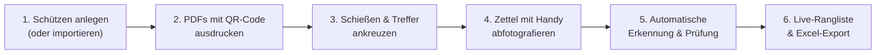

# bgScore – Automatische Blasrohr-Schießzettel-Auswertung

[](https://www.python.org/)
[](https://palletsprojects.com/p/flask/)
[](LICENSE)

**bgScore** ist eine leistungsfähige, moderne Webanwendung zur **vollautomatischen optischen Erfassung, Auswertung und Verwaltung von Blasrohr-Schießzetteln (Wertungsbögen)**.

Kein lästiges manuelles Zusammenrechnen von Wertungszetteln mehr: Einfach den Schießzettel mit dem Smartphone oder einer Webcam fotografieren – bgScore erkennt den Schützen, die Hälfte (A oder B) des Durchgangs sowie alle angekreuzten Treffer in Sekunden und aktualisiert sofort die Live-Ergebnisliste.

---

## 📖 Ausführliche Dokumentation

Für eine detaillierte Schritt-für-Schritt-Anleitung mit vielen Praxistipps für Wettkampfleiter und Auswerter lesen Sie bitte das:
👉 **[Ausführliche Benutzerhandbuch (BENUTZERHANDBUCH.md)](BENUTZERHANDBUCH.md)**

---

## ✨ Kernfunktionen im Überblick

- 🎯 **Optische Zettelauswertung (Computer Vision):**
  - Erkennt automatisch die 5 Passen-Tabellen auf dem Wertungsbogen.
  - Automatische Begradigung (Auto-Deskew bis ±14°) bei schräg fotografierten Zetteln.
  - Präzise Trefferauswertung für Ringe 10, 9, 8, 7, 6 und 0 (Miss/Fehlschuss).
  - Funktioniert zu 100 % lokal ohne Cloud-Zwang, ohne API-Kosten und ohne KI-Abo!
- 🏁 **Vollautomatische QR-Code-Erkennung:**
  - Schießzettel enthalten einen ultrakompakten QR-Code (`BG2`-Format mit großen, kontraststarken Modulen, optimiert auch für den DIN-A5-Druck) im Kopfbereich.
  - Beim Fotografieren werden Schütze, Klasse, Verein, Gruppe, Standnummer und Zettelhälfte (Zettel A: Passe 1–5 / Zettel B: Passe 6–10) automatisch erkannt und zugeordnet.
- 📱 **Multi-Device & Smartphone-Support:**
  - Der Vereins-Laptop dient als Server. Helfer verbinden ihr Smartphone einfach per QR-Code ("Handy-Link") im lokalen WLAN.
  - Integrierter **Zielrahmen** im Kamera-Sucher für optimales Ausrichten.
  - Unterstützt sowohl die direkte Live-Kamera (HTTPS) als auch die native Smartphone-Kamera (HTTP).
- 📄 **Druckfertiger Schießzettel-PDF-Generator (4 Seitenlayouts):**
  - Erstellt offizielle, normgerechte Wertungsbögen im Original-Layout.
  - **1 Zettel pro DIN A4 Seite** (klassisch groß im Hochformat) oder **2 Zettel auf einer DIN A4 Seite** (je Schütze Zettel A + B im DIN-A5-Format nebeneinander mit Schnittlinie).
  - **2 Schützen pro Seite (gleiche Schießhälfte):** Ideal für gemeinsame Klemmbretter an den Scheiben – wahlweise mit **automatischer Paarung benachbarter Schützen einer Gruppe (Scheibe 1+2, 3+4, …)** inklusive nicht vorbefülltem Zettel bei freier Nachbarscheibe oder als **interaktive manuelle Zusammenstellung** von jeweils zwei Schützen.
  - Wahlweise als Gesamt-PDF, aufgeteilt nach Klassen, Vereinen oder Gruppen/Ständen (auch als gebündeltes ZIP-Archiv) sowie Leervorlagen-Druck (1 oder 2 Zettel pro Seite).
- 🏆 **Echtzeit-Ergebnisliste:**
  - Live-Aktualisierung alle 3 Sekunden – ideal für die Anzeige auf einem Großbildschirm oder Beamer im Schützenhaus.
  - Rangberechnung: Höchste Ringzahl, bei Gleichstand Auswertung der 10er und 9er.
  - Medaillen-Kennzeichnung (🥇 Gold, 🥈 Silber, 🥉 Bronze) und Schnellfilter nach Klassen.
- 📊 **Excel- & CSV-Ergebnisexport (Ergebnisliste):**
  - **.xlsx:** Professionell formatierte Arbeitsmappe mit Wettkampf-Deckblatt, farbigen Tabellen und allen 10 Passen.
  - **.csv:** Standardisiert mit Semikolon-Trennung und UTF-8-BOM für den direkten Excel-Doppelklick.
- 🔄 **JSON-Turnierimport & -Export (Wettkampf & Klassen):**
  - Importiert und exportiert Turniername, Datum, Klassen und Schützen (Name, Vorname, Klasse, Verein, Gruppe, Scheibe) in Sekundenschnelle als strukturierte `.json`-Datei zur Datensicherung oder zum Austausch zwischen Rechnern.
  - Inklusive Vorab-Validierung und interaktiver Live-Vorschau aller Schützen und Klassen vor dem Speichern.
- 📦 **Portabler Standalone-Betrieb unter Windows (`bgScore.exe`):**
  - Kann dank PyInstaller / `auto-py-to-exe` als eigenständige `.exe`-Datei ohne Python-Installation auf jedem Windows-PC (oder direkt vom USB-Stick) gestartet werden.

---

## 🔄 Ablauf eines Wettkampfs



---

## 🚀 Schnellstart (Quick Start)

### Option A: Direktstart über die eigenständige Windows-EXE (ohne Python)
Falls bereits eine fertige `bgScore.exe` (im Ordner `output\`) vorliegt:
1. Klicken Sie doppelt auf **`output\bgScore.exe`**.
2. Der lokale Server startet automatisch und öffnet `http://localhost:5000` in Ihrem Standard-Webbrowser.
3. Die Datenbank (`bgscore.db`) wird dauerhaft direkt im selben Ordner neben der `.exe`-Datei angelegt – ideal auch für den portablen Einsatz vom USB-Stick.

### Option B: Installation & Start über Python

#### Voraussetzungen
- **Python 3.10 oder neuer** (empfohlen: Python 3.11 / 3.12)
- Ein aktueller Webbrowser (Chrome, Edge, Firefox oder Safari)

#### 1. Installation
Klonen Sie das Repository oder laden Sie den Quellcode herunter:
```bash
git clone https://github.com/IhrUsername/bgScore.git
cd bgScore
```

Installieren Sie die benötigten Python-Pakete:
```bash
pip install -r requirements.txt
```

#### 2. Starten

**Unter Windows (per Batch-Starter):**
Klicken Sie doppelt auf die Datei **`start_bgscore.bat`**.  
Der lokale Server startet und öffnet die Anwendung automatisch im Browser unter:
👉 `http://localhost:5000`

**Manuell über die Konsole (Windows / Linux / macOS):**
```bash
python app.py
```

#### 3. Eigene Windows-EXE erstellen (optional)
Um aus dem Python-Quellcode eine eigenständige `output\bgScore.exe` zu generieren:
- **1-Klick-Build (PyInstaller):** Doppelklick auf **`build_exe.bat`** (benötigt `pip install pyinstaller`).
- **Grafische Oberfläche (`auto-py-to-exe`):** Doppelklick auf **`starte_auto_py_to_exe.bat`** (lädt automatisch `auto-py-to-exe-config.json`).

### 4. Smartphone im WLAN verbinden
1. Klicken Sie in der Kopfleiste auf **📱 Handy-Link**.
2. Scannen Sie den angezeigten QR-Code mit der Smartphone-Kamera.
3. Schon können Sie Schießzettel direkt mit dem Handy am Schießstand fotografieren!

---

## 📂 Projektstruktur

```
bgScore/
├── app.py                      # Flask Webserver & REST-API-Endpunkte
├── evaluator.py                # Bildanalyse, Deskew, Boxensuche & Kreuz-Erkennung
├── qr_codec.py                 # QR-Code Generator & Decoder (BG2-Kompaktformat + Reed-Solomon)
├── scorecard_pdf.py            # PDF-Generator für Schießzettel (1/2 pro A4, Paarungslogik)
├── start_bgscore.bat           # Windows 1-Klick-Starter (Python)
├── build_exe.bat               # Erstellt eigenständige output/bgScore.exe via PyInstaller
├── starte_auto_py_to_exe.bat   # Öffnet auto-py-to-exe mit vorkonfigurierter Projektdatei
├── auto-py-to-exe-config.json  # Build-Konfiguration für auto-py-to-exe
├── requirements.txt            # Liste der Python-Abhängigkeiten
├── bgscore.db                  # SQLite-Datenbank (wird beim 1. Start automatisch erstellt)
├── BENUTZERHANDBUCH.md         # Ausführliches Benutzerhandbuch
├── README.md                   # Diese Schnellübersicht
├── cert.pem / key.pem          # SSL-Zertifikate für HTTPS-Live-Kamera
├── output/                     # Zielordner für die generierte bgScore.exe
├── static/
│   ├── css/style.css           # Responsives UI-Styling
│   └── js/app.js               # Client-Logik, Kamera-Steuerung, PDF-Paarung, Live-Ticker
├── templates/
│   └── index.html              # Single-Page-Application Web-Interface
└── Vorlage/                    # Offizielle DSB-Vorlagenmuster (.docx / .pdf)
```

---

## 🛠️ Verwendete Technologien & Bibliotheken

- **Backend:** [Flask](https://flask.palletsprojects.com/), Python SQLite3
- **Bildverarbeitung:** [Pillow (PIL)](https://python-pillow.org/), [NumPy](https://numpy.org/)
- **QR-Code-Erzeugung & -Dekodierung:** [qrcode](https://pypi.org/project/qrcode/) & integrierter Pure-Python-Decoder (`qr_codec.py`)
- **PDF-Generierung:** [ReportLab](https://www.reportlab.com/)
- **Tabellen-Export:** [openpyxl](https://openpyxl.readthedocs.io/)
- **Standalone-Packaging (optional):** [PyInstaller](https://pyinstaller.org/) / [auto-py-to-exe](https://pypi.org/project/auto-py-to-exe/)
- **Frontend:** Vanilla JavaScript (ES6+), Modernes CSS mit Flexbox/Grid, responsives Mobil-Layout

---

## 📄 Lizenz

Dieses Projekt steht unter der **GNU General Public License v3.0 (GPL-3.0)**. Nähere Informationen finden Sie in der Datei [LICENSE](LICENSE).

---

*Viel Erfolg und Gut Schuss mit bgScore!* 🎯
